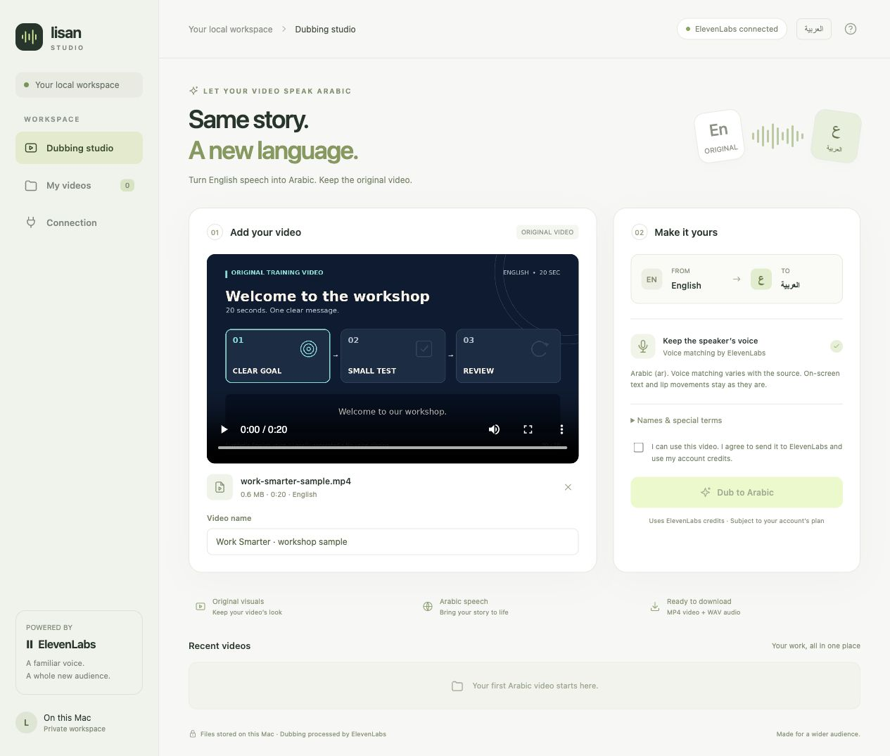

# Lisan Studio · لسان

**Upload an English video. Preview and download an Arabic dub.**

Lisan Studio is an open-source desktop workflow with a simple browser interface, Arabic and English UI, and local video export. It uses the ElevenLabs Dubbing Projects API to generate Arabic speech, then combines that audio with the original video on your computer.

**The code is free to use and modify under MIT. Dubbing requires your own ElevenLabs API key, access to Dubbing, an internet connection, and sufficient credits. Videos are uploaded to ElevenLabs for dubbing.**

[الدليل بالعربي](README.ar.md) · [Contributing](CONTRIBUTING.md) · [License](LICENSE)



## What you can do

- Drag and drop a video, browse your files, or try the included 20-second English sample.
- Switch the interface between English and Arabic, including right-to-left layout.
- Dub English speech into Arabic with ElevenLabs voice matching.
- Follow upload, preparation, dubbing, and export progress.
- Compare the original and Arabic videos, and download MP4 video or WAV audio.
- View the translation and download Arabic SRT subtitles when the provider supplies a transcript.
- Keep your video history locally and resume a known ElevenLabs project after an interruption.

## Start on a Mac

1. Install **Node.js 22 or newer** from [nodejs.org](https://nodejs.org/).
2. [Download the source ZIP](https://github.com/kamelsaif/lisan-studio/archive/refs/heads/main.zip) and extract it, or clone this repository.
3. Open **Open Lisan Studio.command** inside the extracted project folder. The first launch installs the dependencies and builds the server. Keep the folder together.
4. The app opens at **http://127.0.0.1:4317**. You can close the launcher window once it opens.

If macOS opens the launcher as text or says it is not executable, open Terminal in the project folder and run:

```sh
chmod +x "Open Lisan Studio.command" "Stop Lisan Studio.command"
./"Open Lisan Studio.command"
```

Use **Stop Lisan Studio.command** after active jobs finish. Closing the browser leaves the app running so a dub can continue.

## Start from a terminal

```sh
git clone https://github.com/kamelsaif/lisan-studio.git
cd lisan-studio
npm ci
npm start
```

Open **http://127.0.0.1:4317** in your browser. `npm start` builds the server before launching it. Stop this terminal session with **Ctrl+C** after a job finishes.

The Mac launchers are provided for convenience. The terminal workflow uses Node.js and platform-specific FFmpeg/FFprobe dependencies; macOS is the tested desktop platform. Other supported dependency platforms can use the terminal commands, but a successful install is not a guarantee that every codec or system will work.

## Connect and dub

1. Open **Connection** and enter your own ElevenLabs API key with Dubbing permissions. See [ElevenLabs authentication](https://elevenlabs.io/docs/api-reference/authentication).
2. Choose whether to remember the key on this computer, then connect.
3. Add a video and preview it. Give it a name and optionally add short names or terms.
4. Confirm that you can use the video and agree to upload it and use your ElevenLabs credits.
5. Choose **Dub to Arabic**. When processing finishes, compare both videos and download your results.

A real 20-second English sample completed an English-to-Arabic dub and local MP4/WAV/SRT export during development on macOS. This is a sample verification; review the meaning, pronunciation, voice match, and timing of each output before sharing it.

## Files, privacy, and limits

| Item | Behavior |
| --- | --- |
| Input | MP4, MOV, WEBM, MKV, M4V, or AVI, up to 3 GiB, with readable video and spoken audio |
| Language | English (`en`) to Arabic (`ar`); no particular regional accent is promised |
| Video | Original visuals are preserved; H.264 video is copied, other supported codecs are converted to H.264 |
| Duration | Output uses the original duration; shorter audio is padded with silence and longer audio is trimmed |
| Storage | Source uploads, results, and job history stay in `data/jobs/` on your computer |
| Remembered key | Stored in `data/connection.json`, with restricted file permissions on macOS/Linux; it is not encrypted |
| Provider | ElevenLabs receives the source media and performs the dubbing; its plan, credit, content, and service limits apply |
| Network | The server binds to `127.0.0.1` and rejects unexpected host/origin requests; use it as a local app |

The API key is entered through the local browser and sent to the local backend for validation. It is never returned by the app's config or job APIs, and it is not stored in browser local storage. **Disconnect & remove saved key** removes the saved credential. The server also accepts `ELEVENLABS_API_KEY` from its environment; `.env` files are not loaded automatically.

The app does not translate text already in the image or synchronize lip movements. Arabic subtitles are a separate SRT download, not burned into the video. It processes one job at a time. Use only content you have permission to upload and dub.

Do not commit or share `data/`, API keys, `.env` files, logs, or private videos. They are excluded by `.gitignore`. Generated server bundles and installed dependencies are built/downloaded locally and are also excluded from Git.

## Recover an interrupted job

Reconnect and choose **Resume existing project** when a job already has an ElevenLabs project ID. This retrieves the existing dub rather than creating a new paid project.

If an upload ended before its project ID was received, the app marks it for review. Check your ElevenLabs account before creating another project: the first request may have consumed credits. The app does not automatically retry an uncertain creation request.

## Develop and test

```sh
npm ci
npm run check
npm test
npm start
```

Tests use a local mock provider and real FFmpeg export. They need no API key, make no ElevenLabs generation calls, and do not spend ElevenLabs credits. The WAV fixture contains English synthetic speech, not a generated Arabic result.

| Path | Purpose |
| --- | --- |
| `public/` | Frontend, styles, icon, and original English sample |
| `server/app.mjs` | Local API, connection, jobs, ElevenLabs integration, and media export |
| `server/index.mjs` | Local server entry point |
| `scripts/build.mjs` | Bundles the server for faster startup |
| `test/` | Mocked workflow, validation, recovery, and subtitle tests |
| `docs/` | Reviewed interface screenshot and third-party notices |

`npm run build` creates `server/launch.mjs` and `server/core.mjs`. FFmpeg and FFprobe are installed through npm. Keep `package-lock.json` so another developer can reproduce the dependency versions.

API references: [Create dubbing project](https://elevenlabs.io/docs/api-reference/dubbing/create-project) and [Get language target](https://elevenlabs.io/docs/api-reference/dubbing/language-targets/get-language-target).

## License and contributions

Copyright © 2026 Kamel Abdullatif. The project code is available under the [MIT License](LICENSE): you may use, modify, and redistribute it, including commercially, while retaining the copyright and license notice. Dependencies and third-party services keep their own licenses and terms; see [third-party notices](docs/THIRD_PARTY_NOTICES.md).

Fork the repository, try a change, and open a pull request. [Contributing](CONTRIBUTING.md) explains the local workflow. Lisan Studio is an independent community project and is not an official ElevenLabs product.
